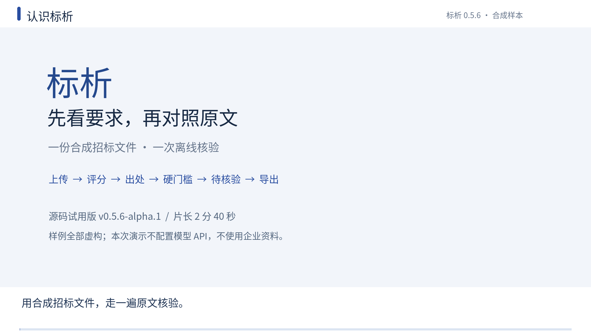
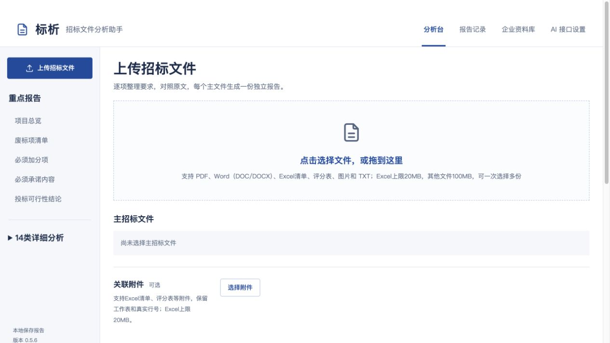
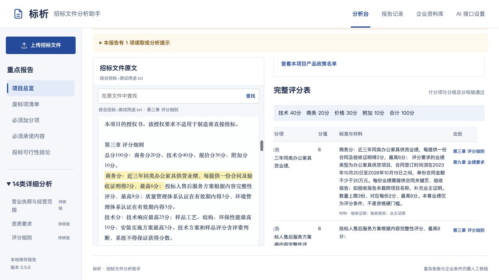
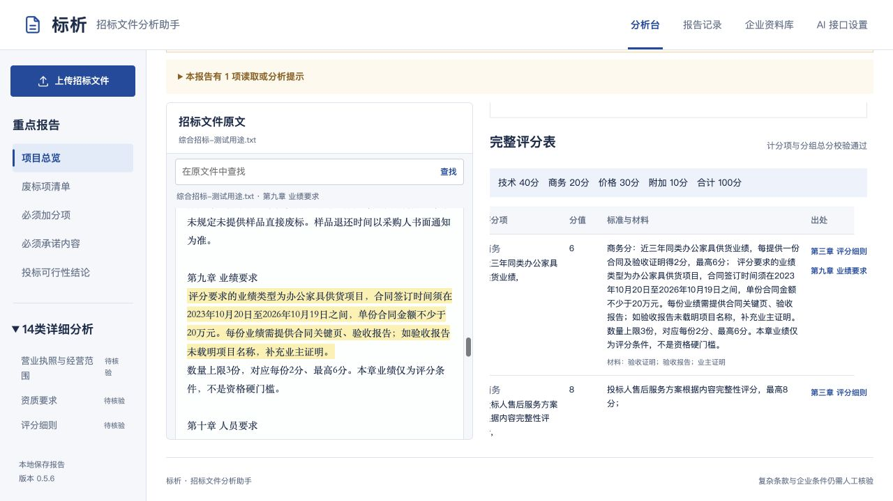
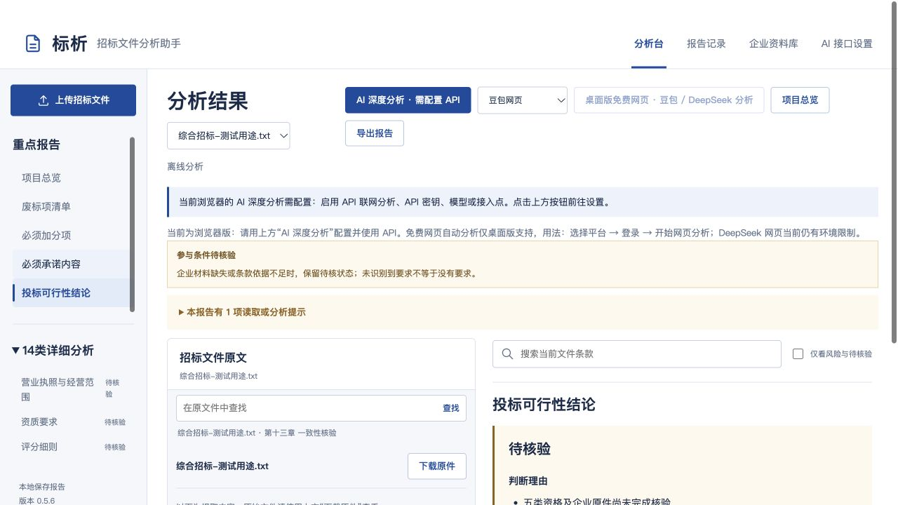

# 标析：先看演示，再动手试用

标析帮助整理招标要求、评分与风险，并把结果连回原文，供人工核对。本页使用全部虚构的合成样本，带你走一遍“上传 → 离线分析 → 查看评分与风险 → 对照原文”。

**转发给别人：[打开演示与试用版本页](https://github.com/X9728771115-dotcom/biaoxi/releases/tag/v0.5.6-alpha.1)。** 不需要 GitHub 账号就能看说明、下载视频与资料包。

| 你想做什么 | 直接打开 |
| --- | --- |
| **1. 先看演示，不安装** | [下载演示视频（MP4，2 分 40 秒）](https://github.com/X9728771115-dotcom/biaoxi/releases/download/v0.5.6-alpha.1/biaoxi-demo-v0.5.6-alpha.1.mp4) |
| **2. 下载演示与试用资料** | [下载资料包（ZIP）](https://github.com/X9728771115-dotcom/biaoxi/releases/download/v0.5.6-alpha.1/biaoxi-trial-v0.5.6-alpha.1.zip)，完整解压后打开 `00-开始这里.html` |
| **3. 按步骤亲自操作** | [阅读完整试用指南](guide.md)，需要时[下载纯文本说明](https://github.com/X9728771115-dotcom/biaoxi/releases/download/v0.5.6-alpha.1/biaoxi-trial-guide-v0.5.6-alpha.1.txt) |

视频由**实际界面截图配字幕编排，不是连续录屏，无配音**。下载到本机后即可播放。资料包包含视频、图解、说明、反馈模板和合成 TXT / PDF；不包含安装程序、模型或 npm 依赖。

## 当前适合怎样试用

当前版本是 **`v0.5.6-alpha.1` 源码试用版，没有可双击安装的程序**。第一次接触开发工具，可以先看演示、填反馈；这也能帮助改进产品。

亲自操作需要 Node.js 22（至少 22.13、低于 23）、npm 10.9.8 和 Git。首次安装依赖需要联网，后续本次样本采用离线分析，**不需要模型 API、密钥、平台账号或企业资料**。源码下载、启动和端口说明都在[完整指南](guide.md#路线二从源码亲自操作)。

## 先看四个关键画面

以下是同一次合成样本演示的实际界面；点击图片可查看原尺寸。

| ① 上传合成样本 | ② 核对评分条款 |
| --- | --- |
|  |  |
| 先用 `综合招标-测试用途.txt`，保持“离线分析”和“不选择企业，仅分析文件”。PDF 可另开一次对比。 | 样本有 **10 个评分项、共 100 分**：商务 20、技术 40、报价 30、附加 10。这是采购条款分值，不是企业已取得的分数。 |
| **③ 打开出处，逐字比较** | **④ 资料不足，保持待核验** |
|  |  |
| TXT 按章节定位。点“第九章 业绩要求”后，需要时手动滚动左侧原文面板查看高亮，并核对时间、金额和材料要求。章节标签本身不表示已经核实。 | 本次没有企业证据，可行性结论应保持“待核验”。缺资料不能直接解释为企业已符合、已不符合，或保证可以投标。 |

再留意三处刻意设置的边界：样品未提供时对应项不得分；强制节能证明与环保加分分别核对；两个截止日期互相冲突，应待澄清。正文提到附件 A/B，也不代表完整附件已经上传或核验。

## 轮到你反馈

复制[反馈模板](feedback-template.md)，选择“仅看演示 / 本人从源码操作 / 他人协助操作”，写下哪里有用、哪里看不懂、最希望改什么。没做的步骤填“未执行”，不知道的填“不清楚”。

通过邀请人约定的方式私下交回即可。**反馈默认不公开，只有你明确同意的内容与身份才能公开整理。** 熟悉 GitHub 的人也可以在[公开 Issues](https://github.com/X9728771115-dotcom/biaoxi/issues) 提交不含敏感信息的问题；Issue 内容本身会公开。

本轮只使用合成资料。不要提交真实招标文件、公司证照、客户材料、账号或密钥；截图与日志请先移除个人路径等信息。仅看演示记为演示反馈，不计为成功安装或实际采用；本页不代表已有试用者、真实模型 API 验证或真实项目验收通过。

想继续了解，可查看[功能与边界](../features-and-limits.md)、[验证记录](../validation.md)和[源码主页](../../README.md)。
